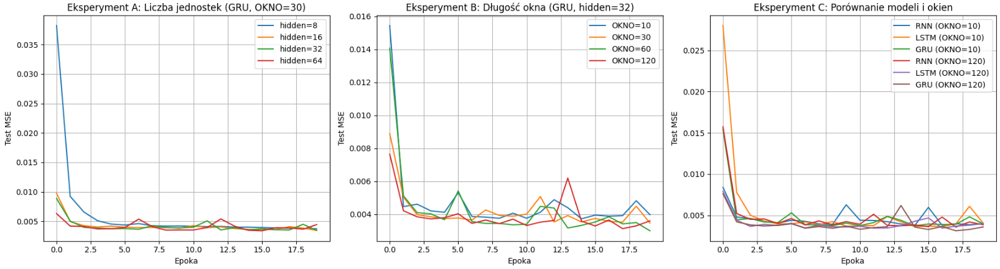

**Przedmiot:** Uczenie głębokie w systemach rozpoznawania i przetwarzania mowy
**Zajęcia nr / temat:** Sieci rekurencyjne: budowa i uczenie
**Autor / grupa:** Adrian Zygmunt GL 5.4
**Data:** 22.10.2026

## 1. Cel ćwiczenia
Celem zadania jest zaimplementowanie prostego modelu sieci rekurencyjnej (RNN) w bibliotece PyTorch i nauczenie go przewidywania kolejnej próbki szeregu czasowego (sygnał sinusoidalny z szumem). Dodatkowo celem jest eksperymentalne sprawdzenie, jak liczba jednostek ukrytych (hidden), długość okna wejściowego (OKNO) oraz typ komórki (SimpleRNN, LSTM, GRU) wpływają na jakość prognozy.

## 2. Metoda i implementacja

- Wykorzystane narzędzia i modele.
Python, biblioteki: numpy, matplotlib, pytorch
Modele: SimpleRNN, LSTM oraz GRU
- Najważniejsze fragmenty kodu (lub link do repozytorium/notatnika). 
(wklej gita)
- Konfiguracja (parametry, dane).
Parametry optymalizacji (stałe w eksperymentach): Liczba epok: 20, Learning rate (lr): 0.01 (1e-2), Batch size: 64 ,Optymalizator: Adam (z użyciem clippingu gradientu na poziomie 5.0)
Metodologia badawcza: Każda badana konfiguracja została wytrenowana trzykrotnie z użyciem ziaren losowości (seed = 0, 1, 2). Ostateczny wynik MSE dla konfiguracji stanowił średnią z wyników testowych z 5 ostatnich epok każdego z 3 przebiegów. W każdym eksperymencie modyfikowano tylko jeden parametr, pozostawiając resztę na poziomie wartości referencyjnych.

Hipotezy przed wykonaniem eksperymentów:
Eksperyment A (liczba jednostek): Zwiększenie liczby jednostek ukrytych początkowo zmniejszy błąd predykcji, ale po przekroczeniu pewnego progu (np. 32) poprawa będzie znikoma. Zbyt rozbudowana sieć jedynie wydłuży czas treningu i zwiększy ryzyko przeuczenia.

Eksperyment B (długość okna): Wydłużenie okna czasowego poprawi wyniki, dostarczając sieci szerszy kontekst historyczny potrzebny do uchwycenia okresowości sygnału. Zbyt krótkie okno (np. 10) uniemożliwi modelowi prawidłowe odnalezienie trendu sinusoidy.

## 3. Wyniki
### Eksperyment A: Liczba jednostek (GRU, OKNO = 30)

| Konfiguracja | Liczba parametrów | Test MSE (średnia ± odch.) | Czas treningu |
|---|---|---|---|
| Heurystyka „ostatnia próbka” | 0 | 0.0063 | 0.000917 s |
| GRU, hidden=8 | 417 | 0.0037 ± 0.0000 | 1.23 s |
| GRU, hidden=16 | 1217 | 0.0037 ± 0.0000 | 1.26 s |
| GRU, hidden=32 | 3393 | 0.0038 ± 0.0000 | 1.27 s |
| GRU, hidden=64 | 14081 | 0.0038 ± 0.0001 | 1.27 s |'

### Eksperyment B: Długość okna (GRU, hidden = 32)

| Konfiguracja | Liczba parametrów | Test MSE (średnia ± odch.) | Czas treningu |
|---|---|---|---|
| Heurystyka „ostatnia próbka” | 0 | 0.0063 | 0.00 s |
| GRU, OKNO=10 | 3393 | 0.0041 ± 0.0002 | 1.28 s |
| GRU, OKNO=30 | 3393 | 0.0038 ± 0.0000 | 1.33 s |
| GRU, OKNO=60 | 3393 | 0.0034 ± 0.0002 | 1.35 s |
| GRU, OKNO=120 | 3393 | 0.0034 ± 0.0002 | 1.38 s |

### Eksperyment C: Typ komórki (hidden = 32)

| Konfiguracja | Liczba parametrów | Test MSE (średnia ± odch.) | Czas treningu |
|---|---|---|---|
| RNN, OKNO=10 | 1153 | 0.0042 ± 0.0002 | 1.18 s |
| LSTM, OKNO=10 | 4513 | 0.0042 ± 0.0001 | 1.35 s |
| GRU, OKNO=10 | 3393 | 0.0041 ± 0.0002 | 1.34 s |
| RNN, OKNO=120 | 1153 | 0.0040 ± 0.0000 | 1.17 s |
| LSTM, OKNO=120 | 4513 | 0.0037 ± 0.0001 | 1.55 s |
| GRU, OKNO=120 | 3393 | 0.0034 ± 0.0002 | 1.27 s |
Wykresy:
a)po jednym wykresie na eksperyment, z krzywymi straty testowej wszystkich
konfiguracji na wspólnych osiach;

b)dla najlepszej konfiguracji: krzywe straty treningowej i testowej na jednym
wykresie;

c)dla najlepszej konfiguracji: wykres predykcji na tle rzeczywistego przebiegu (200
punktów testowych).

## 4. Analiza i interpretacja
Wyniki pokazują wyraźną różnicę pomiędzy klasycznym modelem SimpleRNN a komórkami korzystającymi z mechanizmu bramek (LSTM, GRU). Metryka MSE wskazuje, że GRU z oknem o długości 120 najlepiej generalizuje wiedzę na zbiorze testowym, osiągając najniższy błąd. Posiadanie dłuższego okna oznacza dostęp do szerszego kontekstu czasowego, co w klasycznym modelu RNN niesie niebezpieczeństwo zanikających gradientów i prowadzi do znacznie gorszych rezultatów. Heurystyka przewidująca jako wynik ostatnią zbadaną próbkę jest znacznie słabsza (MSE=0.0063) niż wyniki otrzymywane nawet przez podstawowe konfiguracje badanych sieci.

## 5. Wnioski
większenie liczby jednostek ukrytych nie zawsze przekłada się na poprawę wyniku; po przekroczeniu progu 16 jednostek błąd utrzymywał się na zbliżonym poziomie (0.0037-0.0038), co zwiększało jedynie złożoność i czas treningu. Najlepszy wynik predykcji uzyskano przy najdłuższym badanym oknie (120), ponieważ szerszy kontekst pozwala skuteczniej odnaleźć okresowe zależności funkcji sinusoidalnej. Klasyczne sieci RNN reagują na wydłużenie okna znacznie gorzej niż architektury bramkowane, co bezpośrednio wynika z ich skłonności do zanikających gradientów. Wszystkie przetestowane modele dały wyraźnie niższy błąd MSE niż prosta heurystyka "ostatnia próbka okna", udowadniając zasadność użycia sieci neuronowych w tym zadaniu. W trakcie treningu na szerszych warstwach (hidden=64) zauważono większą podatność na fluktuacje krzywej testowej, jednak nie odnotowano skrajnej niestabilności dzięki zastosowaniu przypinania gradientu (clipping). Sformułowane przed eksperymentami hipotezy potwierdziły się, wykazując znikomą poprawę przy przeinwestowaniu w rozmiar warstwy oraz wysoką skuteczność komórek GRU dla długich okien wejściowych.
