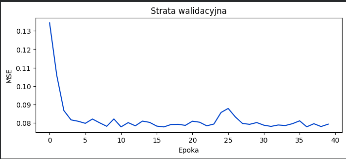
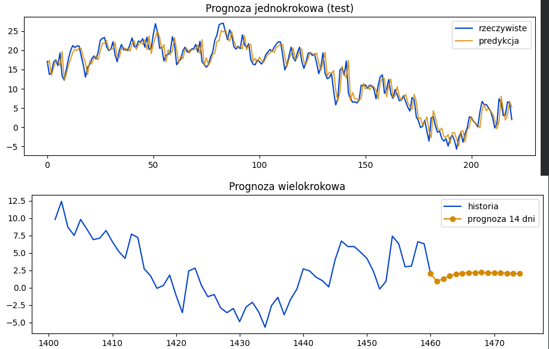

# Sprawozdanie laboratoryjne

**Przedmiot:** Uczenie głębokie w systemach rozpoznawania i przetwarzania mowy
**Zajęcia nr / temat:** Lab 3 / Prognozowanie szeregów czasowych - prognoza wielokrokowa i porównanie z baseline'ami
**Autor / grupa:** Adrian Zygmunt GL 5.4
**Data:** 29.10.2026

## 1. Cel ćwiczenia

Celem ćwiczenia jest sprawdzenie skuteczności modelu GRU w prognozie jedno- i wielokrokowej dla szeregu czasowego. Analizie poddano to, czy rekurencyjna sieć neuronowa wnosi poprawę względem prostych baseline'ów (model naiwny i sezonowy) oraz zbadano wpływ długości okna wejściowego na jakość prognoz.

## 2. Metoda i implementacja

- **Narzędzia i model:** Język Python, biblioteka PyTorch. Zastosowano jednowarstwowy model GRU (`hidden_size=32`) połączony z warstwą liniową. 
- **Dane:** Średnia dzienna temperatura dla Warszawy (2020-2023) pobrana przez API Open-Meteo.
- **Konfiguracja:** Zbiór podzielono na treningowy (70%), walidacyjny (15%) i testowy (15%). Horyzont prognozy (H) wynosił 14 dni. Testowano rozmiary okien czasowych wejściowych na poziomie 3, 7 i 28 dni przy użyciu optymalizatora Adam (epoki=40, lr=0.01). Zrealizowano również odwrócenie osi Y dla lepszej wizualizacji w kodzie. Cały kod: https://github.com/AdrianZygmunt/Uczenie-g-bokie-w-systemach-rozpoznawania-i-przetwarzania-mowy---AdrianZygmunt/tree/main/L3

## 3. Wyniki

**Zadanie 1: Model bazowy i krzywe uczenia**

**

Krzywa straty szybko maleje i stabilizuje się. Nie zaobserwowano silnego zjawiska przeuczenia (brak nagłego wzrostu straty na zbiorze walidacyjnym po początkowym spadku) ani niedouczenia. Najlepsza epoka oscylowała wokół momentu pełnej stabilizacji błędu.

**Zadanie 2: Ocena wielokrokowa na zbiorze testowym (Okno = 28)**
Poniższa tabela przedstawia porównanie MAE i RMSE dla modelu GRU i baseline'ów:

| Metoda | MAE (1 krok) | RMSE (1 krok) | MAE (Wielokrok H=14) | RMSE (Wielokrok H=14) |
|---|---|---|---|---|
| GRU | 1.665 | 2.182 | 2.870 | 3.751 |
| Naiwny (t-1) | 1.793 | 2.309 | 3.466 | 4.276 |
| Sezonowy (t-7) | 3.335 | 4.157 | 3.595 | 4.448 |

**

**Zadanie 3: Wpływ długości okna**
Wyniki weryfikacji dla różnych rozmiarów okna (3, 7, 28) i dwóch ziarn (0, 1):

| Okno | Ziarno | Strata Val (MSE) | MAE 1-krok | MAE Wielokrok |
|---|---|---|---|---|
| 3 | 0 | 0.078963 | 1.754496 | 3.187162 |
| 3 | 1 | 0.079269 | 1.821737 | 3.782196 |
| 7 | 0 | 0.077725 | 1.689964 | 2.740006 |
| 7 | 1 | **0.076965** | 1.715685 | **2.811952** |
| 28 | 0 | 0.077766 | 1.665650 | 2.870775 |
| 28 | 1 | 0.077814 | 1.686261 | 2.960075 |

Najlepsze okno według najniższej straty walidacyjnej to **7 dni** (Ziarno 1, Val MSE = 0.0769).

## 4. Analiza i interpretacja

- **Porównanie z baseline'ami:** Model GRU bije oba baseline'y zarówno w prognozie jedno-, jak i wielokrokowej. Wyniki wielokrokowe są gorsze od jednokrokowych, co wynika ze zjawiska kumulowania się błędu (prognozy w kolejnych krokach opierają się na wcześniejszych predykcjach modelu, które już zawierały błąd).
- **Stosunek do granicy szumu:** Wynik jednokrokowy GRU (MAE ~1.66) jest zauważalnie lepszy (niższy) od szacowanej granicy szumu (MAE ~2.39).
- **Rozmiar okna:** Okno 3-dniowe daje zdecydowanie gorsze wyniki i jest niestabilne, ponieważ brakuje w nim informacji o pełnym cyklu tygodniowym (sezonowości). Okna 7 i 28 dni znacząco poprawiają predykcję, wychwytując wzorce pogodowe, przy czym okno 7-dniowe okazało się optymalne. 
- **Wpływ ziarna:** Przy małym oknie (3) różnice między ziarnami są bardzo duże (np. MAE 3.18 vs 3.78). Dla optymalnych okien (7 i 28) rozrzut między ziarnami jest ułamkowy, a model zachowuje stabilność (wpływ losowej inicjalizacji jest mniejszy niż wybór parametru okna).

## 5. Wnioski

Odpowiedni dobór wejściowego okna pamięci jest kluczowy dla sieci RNN – musi ono obejmować niezbędny kontekst zjawiska (np. cykl tygodniowy). 
Wnioski te mają bezpośrednie przełożenie na przetwarzanie mowy (np. generowanie mowy autoregresyjnie krok po kroku). Odpowiednio długi kontekst jest tam niezbędny do uchwycenia intonacji i brzmienia. Podobnie jak w prognozie pogody, tak i w syntezie mowy błąd modelu kumuluje się na każdym kroku predykcji, co powoduje, że wygenerowany sygnał (dłuższa wypowiedź) może z czasem stawać się coraz bardziej zniekształcony.
