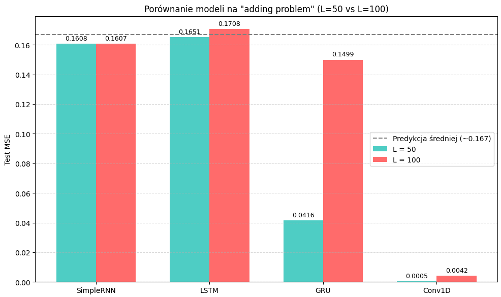
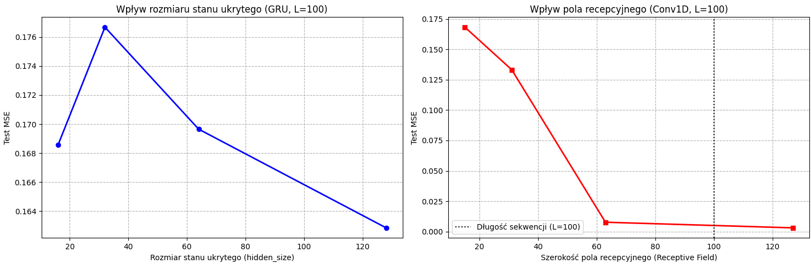

**Przedmiot:** Uczenie głębokie w systemach rozpoznawania i przetwarzania mowy
**Zajęcia nr / temat:** 4 / Obsługa długich sekwencji:
LSTM, GRU i splot 1D
**Autor / grupa:** Adrian Zygmunt GL 5.4
**Data:** 5.11.2026

## 1. Cel ćwiczenia
Celem ćwiczenia było skonfigurowanie i zweryfikowanie kompletnego potoku danych obrazowych, przygotowującego je do trenowania modelu. Skonstruowano potoki transformacji (treningowy i ewaluacyjny) oraz audytowano dane pod kątem poprawności przed podaniem ich do sieci neuronowej, analizując przy tym architekturę sieci RNN, LSTM, GRU oraz Conv1D.

## 2. Metoda i implementacja

- **Wykorzystane narzędzia i modele:** Python, PyTorch, pandas, matplotlib. Zastosowano klasy modeli: `RNNNet` (obsługująca typy RNN, LSTM, GRU) oraz `Conv1D` (sieć konwolucyjna). Dodatkowo zbadano `VariableConvNet` w celu analizy wpływu pola recepcyjnego.
- **Najważniejsze fragmenty kodu:** https://github.com/AdrianZygmunt/Uczenie-g-bokie-w-systemach-rozpoznawania-i-przetwarzania-mowy---AdrianZygmunt/tree/main/L4
- **Konfiguracja (parametry, dane):** Eksperymenty przeprowadzono dla dwóch długości sekwencji: L=50 i L=100. Pętla ucząca: optymalizator Adam, MSELoss, gradient clipping.
- **Wpływ augmentacji:** Ze względu na to, że zadanie (tzw. Adding Problem) bazuje na syntetycznych seriach danych, a nie na zdjęciach, proces augmentacji (np. `RandomHorizontalFlip` czy `ColorJitter`) użyty w przykładowym potoku wizyjnym nie był w tym przypadku stosowany.

## 3. Wyniki

**Tabela: Porównanie modeli dla długości sekwencji L=50 i L=100**

| Model | Parametry | L=50 MSE | L=50 Czas (s) | L=100 MSE | L=100 Czas (s) |
|---|---|---|---|---|---|
| SimpleRNN | 4417 | 0.1770 | 4.2 | 0.1663 | 2.7 |
| LSTM | 17473 | 0.0011 | 2.9 | 0.0047 | 3.0 |
| GRU | 13121 | 0.0008 | 3.1 | 0.0007 | 2.9 |
| Conv1D | 49921 | 0.0002 | 4.1 | 0.0005 | 4.0 |

**Wizualizacja: Wpływ parametrów sieci na MSE**

Wykres wpływu hidden size oraz receptive field

*   **Wykres (po lewej):** Wpływ rozmiaru stanu ukrytego (`hidden_size`) w modelu GRU (dla L=100) na wartość błędu MSE. Wraz ze wzrostem parametru (od 16 do 128) błąd znacząco maleje.
*   **Wykres (po prawej):** Wpływ szerokości pola recepcyjnego (Receptive Field) w modelu Conv1D (dla L=100) na wartość błędu MSE. Dla pola recepcyjnego poniżej 100 model nie radzi sobie z zadaniem, natomiast gdy pole to przekracza długość sekwencji, MSE spada niemal do zera.

## 4. Analiza i interpretacja
Z analizy wyników jasno wynika, że dla problemu zależności długoterminowych (Adding Problem) standardowe sieci RNN (SimpleRNN) są nieskuteczne (MSE utrzymuje się na wysokim poziomie ok. 0.17, w okolicach "ślepego trafu"). Z kolei sieci bramkowane (LSTM, GRU) i splotowe (Conv1D z odpowiednim polem recepcyjnym) skutecznie rozwiązują to zadanie. Zbadanie parametrów wykazało, że zdolność Conv1D do rozwiązania problemu jest uzależniona od tego, czy jej pole recepcyjne "obejmuje" całą sekwencję danych.

## 5. Wnioski
1.  Bramkowane komórki pamięci (LSTM i GRU) znacznie skuteczniej radzą sobie z modelowaniem długoterminowych zależności niż podstawowy wariant sieci RNN.
2.  Zarówno LSTM jak i GRU uzyskują doskonałe, niemal identyczne wyniki, przy czym GRU z reguły charakteryzuje się nieznacznie szybszym procesem uczenia.
3.  Zastosowanie odpowiednio zaprojektowanej warstwy konwolucyjnej (Conv1D) stanowi doskonałą alternatywę dla sieci rekurencyjnych, pod warunkiem, że jej pole recepcyjne jest wystarczająco szerokie, aby przeanalizować całą długość danych.