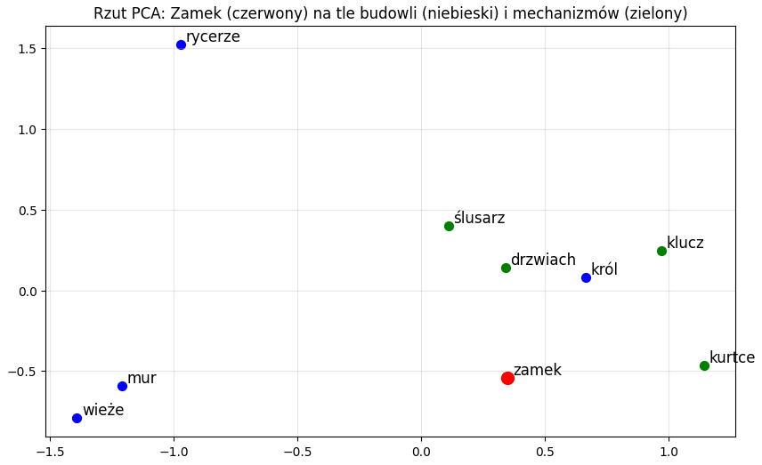
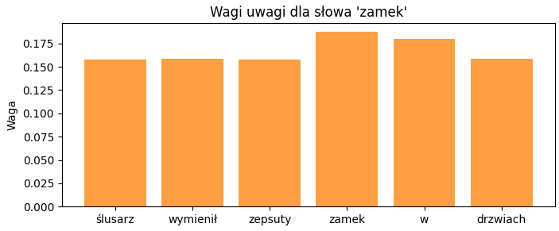

**Przedmiot:** Uczenie głębokie w systemach rozpoznawania i przetwarzania mowy
**Zajęcia nr / temat:** 5 / Wpływ korpusu na tokenizację BPE i embeddingi Word2Vec
**Autor / grupa:** Adrian Zygmunt GL 5.4
**Data:** 12.11.2026

## 1. Cel ćwiczenia
Celem laboratorium było zbadanie procesu przetwarzania tekstu od ciągu znaków do reprezentacji wektorowych. Przeanalizowano wpływ wielkości słownika na podział form fleksyjnych w tokenizacji BPE (Byte Pair Encoding). Zbadano również, w jaki sposób zmiana proporcji znaczeń w korpusie wpływa na osadzenia (embeddingi) wieloznacznego słowa (tzw. problem polisemii) z wykorzystaniem modelu Word2Vec (Skip-gram). Dodatkowo przeprowadzono wizualizację przestrzeni osadzeń za pomocą redukcji wymiarowości PCA oraz przeanalizowano działanie uproszczonego mechanizmu uwagi (attention).

## 2. Metoda i implementacja
- **Wykorzystane narzędzia:** Python, biblioteki: `tokenizers` (HuggingFace), `gensim` (Word2Vec), `scikit-learn` (PCA), `matplotlib`, `numpy`. Obliczenia wykonano w środowisku Google Colab z akceleratorem GPU T4.
- **Dane (Korpus):** Skonstruowano dedykowany korpus obejmujący 64 zdania dla wieloznacznego słowa "zamek", podzielony na:
  - Pulę znaczenia "budowla" (np. *Król zbudował potężny zamek na wzgórzu.*).
  - Pulę znaczenia "mechanizm" (np. *Ślusarz wymienił zepsuty zamek w drzwiach.*).
  - Zdania tła bez słowa "zamek" (np. *Klucz leżał na drewnianym stole w kuchni.*).
- **Tokenizacja BPE:** Przetestowano trzy limity słownika: 50, 150 oraz 500. Tokenizator wykorzystywał pre-tokenizację po spacjach (Whitespace) oraz token `[UNK]` dla znaków nieznanych.
- **Word2Vec:** Użyto modelu Skip-gram (`sg=1`) uczonego przez 200 epok, generującego wektory o wymiarze 50 (`vector_size=50`), z oknem o rozmiarze 3 i zignorowaniem słów rzadszych niż 2 wystąpienia (`min_count=2`): 5]. Do oceny wpływu kontekstu przygotowano drugi wariant korpusu (69 zdań) zdominowany przez znaczenie "budowla".

## 3. Wyniki

**Tabela: Wpływ limitu słownika na tokenizację form niewidzianych (BPE)**

| Limit (Ustawiony) | Faktyczny Rozmiar | Przykład 1: *zamkami* | Przykład 2: *ślusarzem* |
|---|---|---|---|
| **50** | 50 | `['za', 'm', 'k', 'a', 'm', 'i']` | `['ś', 'l', 'u', 's', 'a', 'rz', 'e', 'm']` |
| **150** | 150 | `['za', 'm', 'ka', 'm', 'i']` | `['ś', 'lu', 's', 'a', 'rze', 'm']` |
| **500** | 382 | `['za', 'm', 'ka', 'm', 'i']` | `['ś', 'lu', 's', 'a', 'rze', 'm']` |

**Tabela: Najbliżsi sąsiedzi dla wieloznacznego słowa "zamek" (Word2Vec)**

| Wariant korpusu | Najbliżsi sąsiedzi (wg podobieństwa cosinusowego) |
|---|---|
| **Zbalansowany** (64 zdania) | się (0.861), zaciął (0.853), błyskawiczny (0.843), klucz, (0.835), ale (0.834) |
| **Zdominowany "budowla"** (69 zdań) | mur (0.707), ten (0.706), wysokie (0.700), wieże (0.700), się (0.698) |

**Uwaga (attention) dla zapytania "zamek" w kontekście zdania testowego:**
*Zdanie:* "ślusarz wymienił zepsuty zamek w drzwiach"
*Wagi:* zamek (0.187), w (0.180), wymienił (0.159), drzwiach (0.159), zepsuty (0.158), ślusarz (0.157).

**Wykres 1: Rzut PCA – Wizualizacja przestrzeni osadzeń słowa "zamek" na tle grup semantycznych (budowle i mechanizmy)**

**Wykres 2: Rozkład wag mechanizmu uwagi (attention) dla słowa "zamek" w badanym zdaniu testowym**

## 4. Analiza i interpretacja
Zwiększenie limitu słownika w algorytmie BPE powoduje scalanie częściej występujących ciągów znaków w dłuższe jednostki (subwords). Dla najmniejszego słownika (|V|=50), słowo niewidziane "ślusarzem" zostało rozbite na aż 8 drobnych tokenów, natomiast przy większym słowniku (|V|=150 i 382) skondensowało się do 6 tokenów (połączenia takie jak 'lu', 'rze'). Pokazuje to, jak BPE adaptuje się do słownictwa, płynnie przechodząc od podziału znakowego do podsłownego.

W modelu statycznym Word2Vec to samo hasło "zamek" musi posiadać jeden uśredniony wektor. Gdy korpus był zbalansowany, model Skip-gram przechwycił głównie kontekst "mechanizmu" (najbliższe słowa: zaciął, błyskawiczny, klucz). Sztuczne zdominowanie korpusu zdaniami o budowlach silnie przesunęło wektor słowa "zamek" w przestrzeń semantyczną architektury (najbliższe słowa: mur, wysokie, wieże). Rzut PCA 2D potwierdził wizualną separację klastrów "budowle" oraz "mechanizmy", jednak odległości euklidesowe na płaszczyźnie nie zawsze idealnie odwzorowują pełne (50-wymiarowe) prawdopodobieństwo cosinusowe ze względu na utratę informacji przy rzutowaniu.

Badanie uproszczonego mechanizmu uwagi dla zapytania (Query) "zamek" pokazało, że wyższe wagi przypisywane są słowom z bliskiego kontekstu gramatycznego (jak przyimek "w" - 0.180, czy orzeczenie "wymienił" - 0.159), co stanowi bazę do dynamicznego budowania osadzeń kontekstowych w transformatorach.

## 5. Wnioski
1. Zwiększenie rozmiaru słownika w tokenizatorach podsłownych (BPE) skutecznie zmniejsza długość sekwencji wejściowej poprzez rzadsze "szatkowanie" form fleksyjnych, co z kolei zwiększa zapotrzebowanie na pamięć w tabeli osadzeń (embeddings).
2. Klasyczny model Word2Vec przypisuje zaledwie jeden statyczny wektor dla wyrazu, przez co jego znaczenie semantyczne dla wyrazów wieloznacznych (polisemicznych) stanowi kompromis (uśrednienie) silnie zależny od rozkładu statystycznego słów w korpusie uczącym.
3. Mechanizm uwagi rozwiązuje problem reprezentacji statycznej – ważąc poszczególne słowa ze zdania (dopasowanie zapytania do klucza), potrafi na bieżąco weryfikować, z którym "zamkiem" ma do czynienia i tworzyć unikalną reprezentację (wektor kontekstu) zależną od sąsiedztwa w konkretnej wypowiedzi.