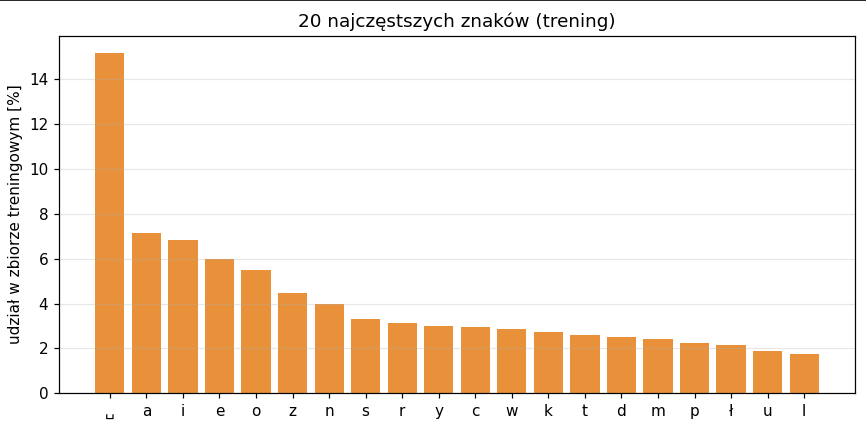
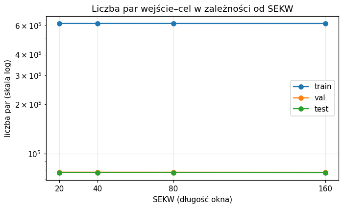
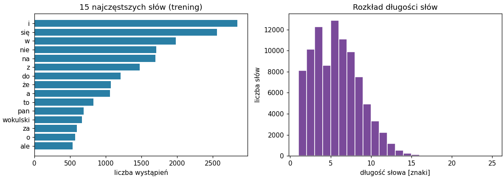

# Sprawozdanie – Laboratorium 6

**Przedmiot:** Uczenie głębokie w systemach rozpoznawania i przetwarzania mowy
**Zajęcia nr / temat:** 6 / Projekt generacyjny, część 1 – przygotowanie danych dla Char-RNN
**Autor / grupa:** Adrian Zygmunt GL 5.4
**Data:** 19.11.2026

## 1. Cel ćwiczenia

Celem laboratorium było przygotowanie polskiego korpusu do zadania przewidywania następnego znaku (Char-RNN): oczyszczenie tekstu, podział na zbiór treningowy, walidacyjny i testowy, zbudowanie słownika znaków oraz utworzenie par wejście–cel (okno `SEKW` znaków i cel przesunięty o jeden znak) w obiektach `Dataset` i `DataLoader`. Zbadano też, jak długość okna `SEKW` wpływa na liczbę par w poszczególnych zbiorach. Dane zostaną użyte na laboratorium 7 do treningu modelu.

## 2. Metoda i implementacja

Wykorzystane narzędzia: Python, numpy, PyTorch (`Dataset`, `DataLoader`), matplotlib, Google Colab.

**Korpus.** Wybrano I tom „Lalki” Bolesława Prusa w postaci pliku TXT z serwisu Wolne Lektury (https://wolnelektury.pl/media/book/txt/lalka-tom-pierwszy.txt). Utwór jest w domenie publicznej (autor zm. 1912); plik zawiera informację, że przy korzystaniu z zasobów Wolnych Lektur należy przestrzegać ich zasad wykorzystania (https://wolnelektury.pl/info/zasady-wykorzystania/). Rozważono także gotowe zbiory z Hugging Face (m.in. Polish Dynaword, polish-pre1918-corpus) – są to agregaty o mieszanych licencjach (np. CC-BY-SA, a część tłumaczeń z Wolnych Lektur nadal objęta prawem autorskim), przez co wymagają sprawdzania warunków dla każdego źródła. Wśród zbiorów z Kaggle i pokrewnych katalogów nie wybrano żadnego, który byłby prostszy licencyjnie od pojedynczego tekstu w domenie publicznej. Powieść dostarcza różnorodnych wzorców: narracji, dialogów zapisanych z myślnikiem, interpunkcji, wielkich liter i bogatej fleksji z polskimi znakami diakrytycznymi. Surowy plik ma 784 082 znaki.

**Przygotowanie tekstu.** Plik odczytano jako UTF-8 i obejrzano jego początek, środek i koniec. Zastosowano: normalizację NFC, zamianę `\r\n` na `\n` (9 851 znaków), usunięcie stopki Wolnych Lektur (1 532 znaki) oraz nadmiaru pustych linii (66 znaków). Znaczników HTML i wielokrotnych spacji nie było. Zachowano wielkość liter i interpunkcję; krótki nagłówek (autor, tytuł, ISBN, „Tom I”) pozostał w tekście. Po czyszczeniu korpus ma 772 633 znaki; nie wykryto powielonych akapitów (4 064 akapity dłuższe niż 40 znaków).

Fragment po oczyszczeniu:

```text
— Wariat! wariat!… Awanturnik!… Józiu, przynieś no jeszcze piwa. A która to butelka?

— Szósta, panie radco. Służę piorunem!… — odpowiadał Józio.

— Już szósta?… Jak ten czas leci!… Wari
```

**Podział.** Tekst podzielono przed utworzeniem okien na trzy rozłączne, ciągłe fragmenty w proporcji 80/10/10 %, a granice przesunięto do najbliższego końca linii (indeksy 618 150 i 695 625). Trening jest największy, bo na nim uczone są wagi i budowany słownik; walidacja służy do śledzenia jakości, test do oceny końcowej. Każdy zbiór ma dość tekstu na okna do 160 znaków. Sąsiednie okna współdzielą `SEKW-1` znaków, więc losowy podział gotowych okien groziłby przeciekiem danych; dlatego okna powstają wewnątrz fragmentów, w osobnych `Dataset`.

**Słownik i dane.** Słownik `stoi`/`itos` zbudowano tylko na treningu (posortowany zbiór znaków) i użyto go we wszystkich zbiorach; ID 0 zarezerwowano dla znaku nieznanego `<unk>`. `DatasetZnakowy` zwraca `x = dane[i:i+SEKW]` i `y = dane[i+1:i+SEKW+1]`, liczba par to `max(0, N − SEKW)`, krok okna wynosi 1. Ustawienia: `SEKW = 40`, `batch_size = 32`; trening: `shuffle=True`, `drop_last=True`; walidacja i test: `shuffle=False`, `drop_last=False`; `torch.manual_seed(0)`.

Kod: https://github.com/AdrianZygmunt/Uczenie-g-bokie-w-systemach-rozpoznawania-i-przetwarzania-mowy---AdrianZygmunt/tree/main/L6

## 3. Wyniki

**Tabela: Podział korpusu i liczebności (SEKW = 40, batch = 32)**

| Zbiór | Znaki | Udział [%] | Różne znaki | Pary | Batche |
|---|---|---|---|---|---|
| train | 618 150 | 80,01 | 101 | 618 110 | 19 315 |
| val | 77 475 | 10,03 | 74 | 77 435 | 2 420 |
| test | 77 008 | 9,97 | 81 | 76 968 | 2 406 |

Każdy zbiór to 1 dokument (jeden tekst podzielony na fragmenty ciągłe).

**Kontrola danych.** Rozmiar słownika V = 102 (101 znaków z treningu + `<unk>`). Test kodowania i dekodowania na 1000 znakach treningu oraz na fragmentach val i test przeszedł poprawnie. W walidacji i teście nie wystąpił żaden znak spoza słownika (0 wystąpień), więc `<unk>` nie był używany. Dla każdego zbioru sprawdzono batch ([32, 40], `int64`, ID w zakresie 0..V−1, `x[1:] == y[:-1]`) oraz parę o indeksie i = 123 względem tekstu źródłowego, w tym ostatni znak celu:

- **train:** wejście `'oczątkach roku 1878, kiedy świat polityc'`, cel `'czątkach roku 1878, kiedy świat politycz'`, ostatni znak celu: `z`
- **val:** wejście `', a oni myślą i pewnie mówią: ot, patrza'`, cel `' a oni myślą i pewnie mówią: ot, patrzaj'`, ostatni znak celu: `j`
- **test:** wejście `'Mówiłam mu właśnie o Żydach, a on prosi '`, cel `'ówiłam mu właśnie o Żydach, a on prosi c'`, ostatni znak celu: `c`

**Wykres 1: 20 najczęstszych znaków w zbiorze treningowym**



Najczęstsze znaki: spacja (15,19 %), `a` (7,14 %), `i` (6,83 %), `e` (5,99 %), `o` (5,51 %).

**Tabela: Liczba par (batchy) w zależności od SEKW (ten sam tekst, podział i krok = 1)**

| SEKW | train: pary (batche) | val: pary (batche) | test: pary (batche) |
|---|---|---|---|
| 20 | 618 130 (19 316) | 77 455 (2 421) | 76 988 (2 406) |
| 40 | 618 110 (19 315) | 77 435 (2 420) | 76 968 (2 406) |
| 80 | 618 070 (19 314) | 77 395 (2 419) | 76 928 (2 404) |
| 160 | 617 990 (19 312) | 77 315 (2 417) | 76 848 (2 402) |

**Wykres 2: Liczba par w zależności od SEKW w trzech zbiorach**



Zbiór treningowy ma 93 281 słów (19 584 różnych), średnia długość słowa to 5,27 znaku. Najczęstsze słowa: „i” (2 849), „się” (2 560), „w” (1 984), „nie” (1 712), „na” (1 698); wśród częstych słów pojawia się też imię bohatera „wokulski” (670).

**Wykres 3: Najczęstsze słowa i rozkład długości słów**



## 4. Analiza i interpretacja

Najczęstszym znakiem jest spacja (15,19 %), a po niej częste samogłoski i spółgłoski, co odpowiada typowemu rozkładowi liter w tekście polskim. Słownik liczy tylko 102 pozycje, ale ceną jest długość sekwencji: okno 40 znaków obejmuje zaledwie kilka słów (średnia długość słowa to ok. 5,3 znaku).

Liczba par w zbiorze o długości `N` wynosi `N − SEKW`, więc przy kroku 1 zależność od `SEKW` jest liniowa i słaba w stosunku do rozmiaru zbioru: przejście z 20 na 160 znaków odejmuje dokładnie 140 par w każdym zbiorze, czyli 0,02 % w treningu oraz ok. 0,18 % w walidacji i teście. Kolejne okna silnie się pokrywają (sąsiednie pary współdzielą 97,5 % znaków przy SEKW = 40), więc dłuższe okno nie dodaje nowych przykładów, tylko daje modelowi większy kontekst na parę. Walidacja i test mają ok. 8 razy mniej par niż trening, ale dla każdego z badanych `SEKW` dają ponad 2 400 batchy, więc ocena obejmuje wiele przykładów.

Podział przed utworzeniem okien jest konieczny: sąsiednie okna różnią się o jeden znak, więc losowe rozdzielenie par trafiłoby prawie identyczne przykłady do treningu i walidacji, co dałoby zbyt optymistyczną ocenę. Kontrola par o znanym indeksie potwierdziła, że cel jest wejściem przesuniętym o jeden znak, łącznie z ostatnim znakiem celu, którego nie obejmuje warunek `x[1:] == y[:-1]`.

## 5. Wnioski

1. Podział tekstu na rozłączne, ciągłe fragmenty (80/10/10) przed tworzeniem okien zapobiega przeciekowi danych; słownik zbudowany tylko na treningu pokrył walidację i test w całości (0 znaków spoza słownika), a `<unk>` zabezpiecza kodowanie na przyszłość.
2. Kontrola treści (odkodowanie pary i porównanie z tekstem źródłowym, w tym ostatniego znaku celu) wykrywa błędy przesunięcia, których nie zdradzają kształt tensorów ani zakres ID.
3. Przy kroku okna równym 1 wydłużanie `SEKW` (20 → 160) prawie nie zmienia liczby par (spadek o 140 w każdym zbiorze), ale zwiększa kontekst widziany przez model; wybór `SEKW` jest więc kompromisem między długością zależności a kosztem obliczeń.
